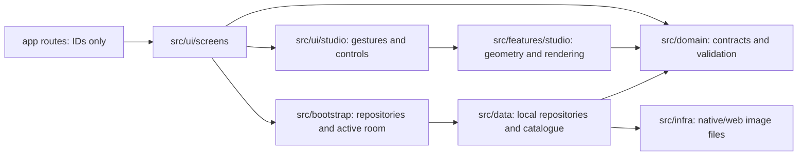

# Current architecture — SDK58 photo studio

The user explicitly removed native AR and consolidated the former SDK57 root/SDK58 companion into one SDK58 Expo Go application on2026-10-28. This is the active architecture; the original AR master and `docs/history` describe retired stages.

## Read the app in this order

1. `app/_layout.tsx` and `src/bootstrap/AppProviders.tsx`: root providers and navigation.
2. `src/bootstrap/repositories.ts`: the single composition point. No auth/cloud branch or capability switch remains.
3. `GalleryScreen`, `SpacesScreen`, `ViewOnRoomScreen`: collection, room capture/import, active-room selection and applying art to an editable copy.
4. `SpaceEditorScreen`: screen orchestration and draft lifecycle. `ArtworkStylePanel`, `StudioControl`, `FramePicker`, `ArtworkDimensions` and `useDirectManipulation` isolate controls/gestures.
5. `features/studio/geometry.ts`, `rendering.ts`, `directManipulation.ts`: wall projection, bounds, exact quad hit testing, shaded edge faces and contact/soft shadows. Native preview and exported SVG share the same graphics.
6. `WallSpaceRepository`, `PersonalArtworkRepository`, then the `.ts`/`.web.ts` image/export adapters: serial writes, validation, snapshots, conflicts, rollback and platform I/O.

## Boundaries

- Routes only parse IDs and render screens. Keep non-route code outside `app/`.
- Domain and feature math have no React Native, network or persistence dependencies.
- Repositories return `Result`; UI never reads AsyncStorage or native files directly.
- Device photo/PNG operations live in `infra`. The Metro resolver selects native/web implementations; no duplicate app package is needed.
- Source imports must not refer to Viro, Firebase or the former companion. Architecture tests enforce the retired branches and default Expo Go start command.
- `artifacts/` is ignored by Git, Metro, TypeScript, ESLint and Jest. It contains local proofs/build outputs/recovery backups, not a second active app.

## Data and gestures

Room/import storage keys and version1 records remain compatible. Old optional appearance fields are readable; visual depth is optional. The original art record is not changed by size/style edits to a room snapshot. Old AR-capture/account data is not deleted; those routes are retired. Native Expo Go sandbox migration remains unverified.

No artwork starts selected. Tap a painting to select; tap again or background to deselect. Unselected art cannot drag. The first touched region owns a pinch: artwork resizes that piece; background changes only the room viewport. Frame/layout/size tools require selection. Room zoom is transient and exports always use the full room. The effect is projected2.5D, not AR tracking or room reconstruction.

## Toolchain

Use the exact root lockfile, `npm ci`, `npm start`, `npm run verify` and `npm run check:bundle`. SDK migration followed [Expo's upgrade guide](https://docs.expo.dev/workflow/upgrading-expo-sdk-walkthrough/). Router58 requires Testing Library14; tests use its async APIs per the [official migration guide](https://github.com/callstack/react-native-testing-library/blob/main/website/docs/14.x/docs/start/migration-v14.mdx). The Jest image transformer and fixture registration compensate for the SDK58/RN0.88 asset-registry mock boundary; real image URLs are checked separately in the served bundle.
