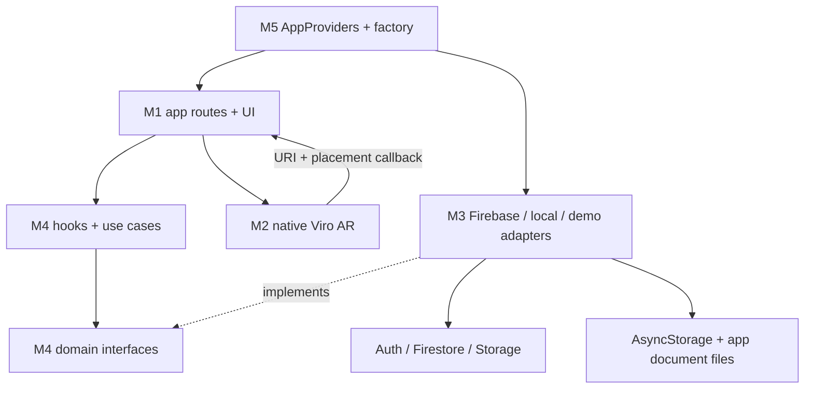
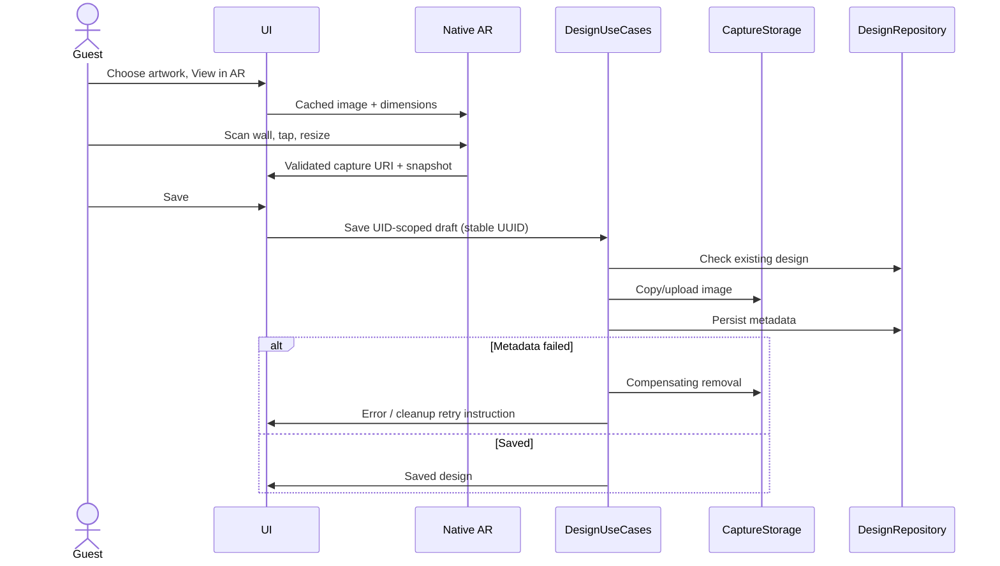

# Architecture and walkthrough

Routes validate scalar IDs and render screens; UI imports repository interfaces through the bootstrap provider, never Firebase. A shared focus-aware resource hook exposes loading/error/retry and invalidates late responses on blur/unmount/account change. Pure authentication validation, catalogue filtering, scale math and design lifecycle logic are separate from rendering.

`createRepositories` selects real Firebase adapters only when public config exists. Otherwise an honest unavailable-auth adapter returns setup-required errors, and the original bundled catalogue is used. Saved designs choose local adapters unless Storage is explicitly enabled and attested verified. No fake accounts ship in release.

AR assets resolve/cache before scene entry. The native scene receives URI/physical cm via context and emits state callbacks. ViroARScene detects only vertical planes and forwards three anchor events to ViroARPlaneSelector. Selector children inherit its tapped anchor-local origin; Y is the outward normal, so image XY is rotated -90 degrees around X into the wall's XZ plane, offset 8 mm. Native testing must confirm upright orientation on real walls. Scene doesn't access repositories, Firebase or navigation. Resize updates width and height in meters using one clamped factor. Reset deselects a wall. Artwork switch keeps the mounted native navigator and changes the texture/dimensions. No transform is persisted.

Capture calls the installed navigator's native `arSceneNavigator.takeScreenshot(name, false)`. The result is treated as unknown, checked for success/URI, file existence/size and decodability. React UI controls are not assumed part of the capture. Camera-background contents require human inspection on hardware. Replacing the AR route releases the native scene and stores a draft in the root provider through login. Process death before saving discards that temporary draft; committed local designs persist.

Use cases: Guest browses/searches/filters/details/AR/capture/local save; User additionally registers/signs in, updates profile, collects favorites and optionally cloud-saves; Admin seeds through a trusted process. Invalid artwork IDs, hidden records, permission denial, absent ARCore, missing files and backend errors produce recoverable UI states.

Native JS is a single application, five modules are handover boundaries only. Source filenames were consolidated where useful (models, repository interfaces, UI primitives and design screens), documented under contracts v1. No cross-module ownership bans exist.
