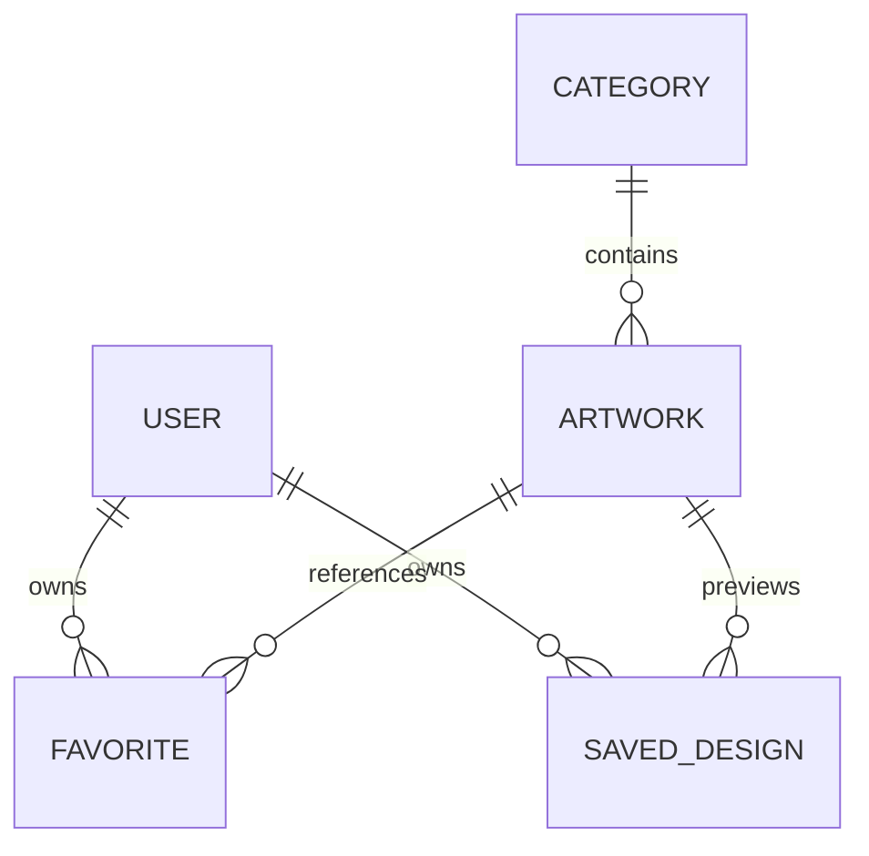

# Data model

- `categories/{id}`: name, slug, order. Public read, admin process writes.
- `artworks/{id}`: title, description, categoryId, HTTPS imageUrl/thumbnailUrl, positive widthCm/heightCm, isFeatured, published/hidden status, createdAt/updatedAt Timestamp. Client query always constrains published status.
- `users/{uid}`: private email, displayName, nullable avatarUrl (currently null only), createdAt/updatedAt Timestamp. Auth email is authoritative. Profile validator forbids extra fields and protects creation time.
- `users/{uid}/favorites/{artworkId}`: artworkId and immutable createdAt Timestamp. Idempotent transaction adds only when absent, delete is idempotent.
- `users/{uid}/savedDesigns/{UUID}`: cloud mode only; artworkId, catalog sourceKind, imageStoragePath, widthCm/heightCm, scaleFactor, frameStyle, createdAt Timestamp. Immutable metadata; no captured file URI, download URL, world transform or anchor ID.
- Cloud file: `designs/{uid}/{UUID}.jpg`. Files are constrained to owner, image MIME and <=10MiB. Catalogue files under `artworks/{id}/` are publicly readable and administrator uploaded.
- Local metadata key: `artspace:designs:v1:{uid}`. File: app documents `designs/{uid}/{UUID}.jpg`. `guest` is a separate local installation scope. Domain data uses ISO UTC; adapters map Firestore timestamps.

No composite indexes are needed by current queries. Search and category filter are in-memory over the published catalogue. Missing/invalid DTO fields are rejected rather than coerced into successful records. Seed IDs/category semantics match bundled data. Mappers and rules currently support catalog source only; custom input is deferred.

Save order: UUID before file upload/copy, metadata after file; metadata failure triggers file removal. Duplicate saves share an in-flight operation and already committed UUIDs return existing records. Delete file before metadata; file deletion failure retains metadata, metadata deletion failure leaves a retryable record and a missing-image UI. Cloud missing-object mapping preserves metadata for retry. Storage deletion treats missing object as successful cleanup. Network/process interruption can still leave an unreferenced file; see SECURITY and NEXT_STEPS for reconciliation limits.
