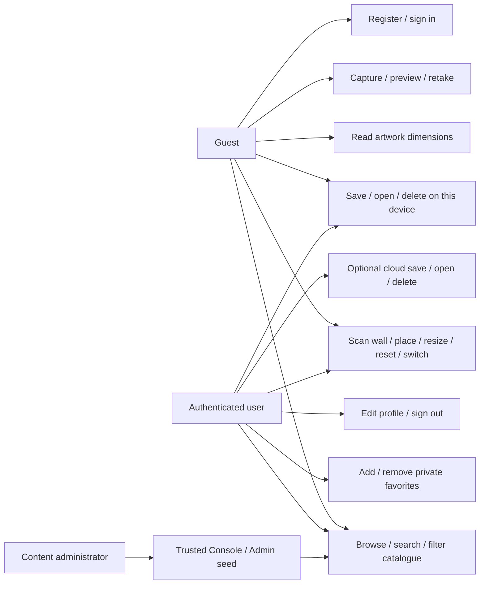

# Use cases and specifications

| Use case | Preconditions / trigger | Main path | Error and alternate paths |
|---|---|---|---|
| UC01 Browse (FR03–05) | Guest opens Gallery | Load published art/categories, search/filter, open detail with dimensions and View in AR | Loading indicator, empty results, image placeholder/reload, retry backend errors, missing/hidden detail |
| UC02 Account (FR01–02) | Configured Firebase; user chooses Register or Sign in | Validate input, SDK email/password operation, profile creation/repair, auth observer and session persistence | Validation before network, normalized credential/rate/network/rules errors; unavailable setup state when unconfigured; no fake sign-in |
| UC03 Wall preview (FR06–12) | Android with native build; artwork selected | Request camera, check ARCore, resolve image, scan vertical plane, tap wall, resize 0.5–2×, switch or reset | Settings/back for denial, support/install guidance, scanning help after timeout, texture failure; unsupported hardware keeps catalogue accessible |
| UC04 Capture (FR13–14) | Wall selected and texture loaded | Native screenshot, validate native result/file/decoding, replace camera route with preview, retain immutable draft | Timeout or missing/undecodable file reports failure; Retake returns to a new AR session. Human must verify camera+art content |
| UC05 Save (FR14/16) | Valid draft; private app storage available | Stable UUID, check duplicate, copy/upload image, write metadata, navigate to saved detail | Local guest scope allowed. Cloud requires sign-in and preserves draft through login. Metadata failure compensates image; cleanup failure asks same-draft retry. No false success on failure |
| UC06 Open/delete design (FR16) | Current user's local/cloud record | List newest first, open image/metadata, confirm Delete, delete image then metadata | Missing image displays fallback; file failure retains metadata, metadata failure retains retry route. Uninstall clears local saves; anchors are never restored |
| UC07 Favorites (FR15) | Signed-in user | Toggle idempotently from detail, list UID favorites, open artwork, remove | Guest prompted to sign in; pending controls prevent repeated actions; optimistic toggles/removals roll back on error; A/B access denied by rules |
| UC08 Profile (FR17) | Signed-in user | Show Auth-authoritative email, validate/clean display name, update profile, sign out | Errors visible, pending controls, profile form resets on UID change. Sign-out selects guest scope rather than leaking account content |
| UC09 Catalogue administration (FR18) | Trusted operator with intended project/ADC | Seed original artwork files and metadata/categories, or edit via Console | No mobile writes/admin role assignment. No automatic credential, project selection or billing changes |

UC03/04 require physical Android evidence. UC02/05 cloud variants require an explicitly selected real Firebase project. Automated tests and source implementation do not close these acceptance gates. FR19–21 are deferred stretch goals.

